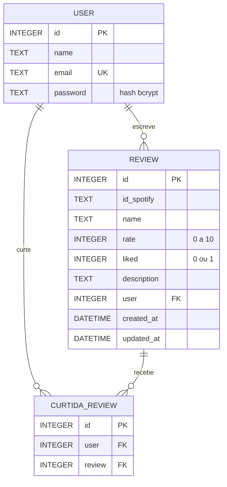

# 🎵 API de Reviews Musicais — Documentação do Backend

API REST (Node.js + Express + SQLite) para cadastro de usuários, avaliação ("review") de músicas do **Spotify** e curtidas em reviews.

> **Escopo desta documentação:** baseada exclusivamente nos arquivos fornecidos (`schema.sql`, `server.js`, `routes/*`, `controllers/*`, `models/*`, `utils/spotify/consultarAPI.js`). Os arquivos `db/app.js`, `utils/geral.js` e `package.json` **não foram enviados**; onde algo depende deles, isso é indicado como *suposição*.

---

## Sumário

1. [Visão geral](#1-visão-geral)
2. [Instalação e configuração](#2-instalação-e-configuração)
3. [Modelo de dados](#3-modelo-de-dados)
4. [Conceitos e convenções da API](#4-conceitos-e-convenções-da-api)
5. [Referência dos endpoints](#5-referência-dos-endpoints)
   - [5.1 Usuários](#51-usuários--apiusers)
   - [5.2 Reviews](#52-reviews--apireviews)
   - [5.3 Curtidas](#53-curtidas--apicurtidas)
6. [Fluxo completo de uso (passo a passo)](#6-fluxo-completo-de-uso-passo-a-passo)
7. [Integração com o Spotify](#7-integração-com-o-spotify)
8. [Pontos de atenção e problemas conhecidos](#8-pontos-de-atenção-e-problemas-conhecidos)
9. [Solução de problemas (FAQ)](#9-solução-de-problemas-faq)

---

## 1. Visão geral

| Item | Valor |
|---|---|
| Base URL (local) | `http://localhost:8080` |
| Prefixo das rotas | `/api` |
| Porta | `8080` (fixa no código) |
| Formato | JSON (`Content-Type: application/json`) |
| Autenticação | **Nenhuma** (sem token/sessão — o `id` do usuário é enviado no corpo das requisições) |
| Dados de músicas | API Web do Spotify (fluxo *Client Credentials*) |

**O que a API faz:**

- **Usuários:** cadastro, login, alteração de nome e exclusão.
- **Reviews:** busca de músicas no Spotify, criação de uma avaliação (nota 0–10 + "gostei" + descrição), consulta de uma review, consulta de todas as reviews de um usuário, atualização e exclusão.
- **Curtidas:** curtir/descurtir a *review* de alguém.

---

## 2. Instalação e configuração

### 2.1 Pré-requisitos

- **Node.js 18+** (o código usa `fetch` global).
- Projeto configurado como **ES Modules** (`"type": "module"` no `package.json`), pois usa `import/export`.
- Uma conta no [Spotify for Developers](https://developer.spotify.com/dashboard) com um *app* criado (para obter Client ID e Client Secret).

### 2.2 Dependências (deduzidas dos imports)

```bash
npm install express cors bcrypt dotenv better-sqlite3
```

> `better-sqlite3` é uma **suposição**: o código usa `db.prepare(...).run/get/all` e `info.lastInsertRowid`, que é a API dessa biblioteca. Ajuste conforme o seu `db/app.js`.

### 2.3 Variáveis de ambiente

Crie um arquivo `.env` na raiz:

```env
SPOTIFY_CLIENT_ID=seu_client_id
SPOTIFY_CLIENT_SECRET=seu_client_secret
```

Sem essas variáveis, as rotas que consultam o Spotify (`/search`, `/get-review`, `/get-user-reviews`) falharão ao obter o token.

### 2.4 Criar o banco de dados

Execute o `schema.sql` no seu arquivo SQLite (o caminho do arquivo é definido em `db/app.js`):

```bash
sqlite3 caminho/do/banco.db < schema.sql
```

### 2.5 Subir o servidor

```bash
node server.js
# Servidor (API) rodando na porta 8080
```

---

## 3. Modelo de dados



### Tabela `user`

| Coluna | Tipo | Regras |
|---|---|---|
| `id` | INTEGER | PK, autoincremento |
| `name` | TEXT | obrigatório |
| `email` | TEXT | obrigatório, **único** (comparação *case-sensitive*) |
| `password` | TEXT | obrigatório — armazena o **hash** bcrypt, nunca a senha pura |

### Tabela `review`

| Coluna | Tipo | Regras |
|---|---|---|
| `id` | INTEGER | PK, autoincremento |
| `id_spotify` | TEXT | obrigatório — ID da faixa no Spotify (ex.: `4uLU6hMCjMI75M1A2tKUQC`) |
| `name` | TEXT | obrigatório — título que o usuário dá à review |
| `rate` | INTEGER | obrigatório, `CHECK (rate BETWEEN 0 AND 10)` |
| `liked` | INTEGER | padrão `0`, `CHECK (liked BETWEEN 0 AND 1)` — o autor **gostou da música?** |
| `description` | TEXT | opcional — texto da review |
| `user` | INTEGER | FK → `user(id)` — autor da review |
| `created_at` | DATETIME | padrão `datetime('now','-3 hours')` (horário de Brasília, fixo UTC-3) |
| `updated_at` | DATETIME | nulo até a primeira atualização |
| — | `UNIQUE (user, id_spotify)` | **um usuário só pode avaliar a mesma música uma vez** |

### Tabela `curtida_review`

| Coluna | Tipo | Regras |
|---|---|---|
| `id` | INTEGER | PK, autoincremento |
| `user` | INTEGER | FK → `user(id)` — quem curtiu |
| `review` | INTEGER | FK → `review(id)` — review curtida |
| — | `UNIQUE (user, review)` | um usuário só curte uma review uma vez |

> **Chaves estrangeiras:** `PRAGMA foreign_keys = ON` está no schema, e **nenhuma FK define `ON DELETE CASCADE`**. Consequência importante: não é possível excluir um usuário que tenha reviews/curtidas, nem uma review que tenha curtidas (ver [seção 8](#8-pontos-de-atenção-e-problemas-conhecidos)).

---

## 4. Conceitos e convenções da API

### 4.1 `liked` × curtida — não confunda!

| Termo | Onde vive | Significado |
|---|---|---|
| **`liked`** | Coluna `review.liked` | O **autor da review gostou da música** (0 ou 1). É um campo da própria review. |
| **Curtida** | Tabela `curtida_review` (rotas `/api/curtidas`) | Um usuário **curtiu a review de outra pessoa** (like social). |

Por isso, nas respostas existem campos parecidos com significados diferentes:

| Campo | Significado |
|---|---|
| `musica.author_liked` | O autor da review gostou da música? |
| `musica.user_liked` | O usuário que está consultando gostou da música (tem review com `liked > 0` para ela)? |
| `musica.qtd_likes` | Soma de `liked` de **todas as reviews** dessa música (`null` se ninguém avaliou ainda). |
| `musica.rate` | Média das notas de todas as reviews da música, ou `"Sem nota"`. |
| `qtd_likes_review` | Quantidade de **curtidas** (tabela `curtida_review`) recebidas pela review. |
| `user_liked_review` | O usuário consultante **curtiu essa review**? |
| `autoral` | O consultante é o autor da review? |

### 4.2 Requisições

- Todas as rotas (exceto `DELETE /api/users/delete/:id`) recebem os dados **no corpo JSON** — inclusive as rotas `DELETE`.
- Sempre envie o header `Content-Type: application/json`.
- JSON malformado retorna:

```json
// 400 Bad Request
{ "message": "JSON inválido no corpo da requisição." }
```

### 4.3 Formato das respostas

A maioria das respostas segue o padrão:

```json
{ "success": true | false, "message": "texto em português", "...": "dados extras" }
```

Erros inesperados trazem também `detail` com a mensagem técnica da exceção:

```json
{ "success": false, "message": "Erro inesperado.", "detail": "FOREIGN KEY constraint failed" }
```

> Em algumas rotas (`get-review`, `get-user-reviews`, `update`, `delete`, `deslike`) o **erro 409 não inclui o campo `success`**.

### 4.4 Códigos HTTP usados

| Código | Quando |
|---|---|
| `200 OK` | Operação concluída (consultas, atualizações, exclusões, login) |
| `201 Created` | Usuário, review ou curtida criados |
| `400 Bad Request` | Validação falhou, e-mail duplicado, review já existente, JSON inválido |
| `401 Unauthorized` | Login com e-mail/senha incorretos |
| `404 Not Found` | Usuário/review/curtida/músicas não encontrados; **também** usado quando o usuário não é dono da review |
| `409 Conflict` | **Qualquer erro inesperado** (exceções, violações de constraint do banco). Não existe `500` nesta API. Também usado em "nome idêntico" no `PUT /users/update`. |

### 4.5 Identificação do usuário

Como não há autenticação por token, o front-end deve **guardar o `user.id` retornado pelo login** e enviá-lo em cada chamada. O nome do campo varia por rota:

| Rota | Campo(s) de identificação |
|---|---|
| `/users/update` | `id` |
| `/users/delete/:id` | `:id` na URL |
| `/reviews/search` | `user_id` |
| `/reviews/create` | `user` |
| `/reviews/get-review` | `user_id`, `review_id` |
| `/reviews/get-user-reviews` | `user_id`, `author_id` |
| `/reviews/update` | `user_id`, `review_id` |
| `/reviews/delete` | `user_id`, `review_id` |
| `/curtidas/like` e `/curtidas/deslike` | `user`, `review` |

---

## 5. Referência dos endpoints

### Resumo

| # | Método | Rota | Descrição |
|---|---|---|---|
| 1 | `POST` | `/api/users/create` | Cadastra usuário |
| 2 | `POST` | `/api/users/login` | Autentica com e-mail e senha |
| 3 | `PUT` | `/api/users/update` | Altera o nome do usuário |
| 4 | `DELETE` | `/api/users/delete/:id` | Exclui usuário |
| 5 | `POST` | `/api/reviews/search` | Busca músicas no Spotify pelo nome |
| 6 | `POST` | `/api/reviews/create` | Cria uma review |
| 7 | `POST` | `/api/reviews/get-review` | Consulta uma review pelo ID |
| 8 | `POST` | `/api/reviews/get-user-reviews` | Lista as reviews de um usuário |
| 9 | `PUT` | `/api/reviews/update` | Atualiza uma review (só o autor) |
| 10 | `DELETE` | `/api/reviews/delete` | Exclui uma review (só o autor) |
| 11 | `POST` | `/api/curtidas/like` | Curte uma review |
| 12 | `DELETE` | `/api/curtidas/deslike` | Remove a curtida de uma review |

---

## 5.1 Usuários — `/api/users`

### 1) Criar usuário

`POST /api/users/create`

**Corpo da requisição**

| Campo | Tipo | Obrigatório | Regras |
|---|---|---|---|
| `name` | string | ✅ | Não pode ser vazio/apenas espaços |
| `email` | string | ✅ | Regex `^[a-zA-Z0-9._%+-]+@[a-zA-Z0-9.-]+\.[a-zA-Z]{2,}$`; deve ser único |
| `password` | string | ✅ | Mínimo 6 caracteres, com **1 maiúscula, 1 minúscula, 1 número e 1 caractere especial** |

**Exemplo (cURL)**

```bash
curl -X POST http://localhost:8080/api/users/create \
  -H "Content-Type: application/json" \
  -d '{
    "name": "Maria Silva",
    "email": "maria@email.com",
    "password": "Senha@123"
  }'
```

**Exemplo (fetch)**

```js
const res = await fetch('http://localhost:8080/api/users/create', {
  method: 'POST',
  headers: { 'Content-Type': 'application/json' },
  body: JSON.stringify({ name: 'Maria Silva', email: 'maria@email.com', password: 'Senha@123' })
});
console.log(res.status, await res.json());
```

**Resposta de sucesso — `201 Created`**

```json
{ "success": true, "message": "Usuário criado com sucesso." }
```

> O `id` do novo usuário **não** é retornado. Para obtê-lo, faça login em seguida.

**Erros**

| Status | `message` | Causa |
|---|---|---|
| 400 | `Nome é obrigatório.` | `name` ausente, vazio ou não-string |
| 400 | `E-mail é obrigatório.` | `email` enviado com tipo diferente de string |
| 400 | `Senha é obrigatória.` | `password` enviado com tipo diferente de string |
| 400 | `Este e-mail já possui uma conta ativa vinculada.` | E-mail já cadastrado |
| 400 | `E-mail inválido.` | Não passou na regex |
| 400 | `Senha inválida. Sua senha deve conter pelo menos uma letra maiúscula e uma minúscula, pelo menos um caracter especial, pelo menos um número e de tamanho 6.` | Senha fora da política |
| 409 | `Erro inesperado.` | Falha não prevista (ver `detail`) |

> ⚠ Não há checagem explícita de **presença** de `email`/`password` (apenas de tipo, se enviados). Sempre envie os três campos; se omitidos, a resposta pode ser um `400` de formato inválido ou um `409` com `detail`.

---

### 2) Login

`POST /api/users/login`

**Corpo da requisição**

| Campo | Tipo | Obrigatório |
|---|---|---|
| `email` | string | ✅ |
| `password` | string | ✅ |

```bash
curl -X POST http://localhost:8080/api/users/login \
  -H "Content-Type: application/json" \
  -d '{ "email": "maria@email.com", "password": "Senha@123" }'
```

**Resposta de sucesso — `200 OK`**

```json
{
  "success": true,
  "message": "Login realizado com sucesso.",
  "user": { "id": 1, "name": "Maria Silva", "email": "maria@email.com" }
}
```

> O hash da senha é removido da resposta. **Guarde `user.id`** no front-end: ele identifica o usuário nas demais rotas.

**Erros**

| Status | `message` | Causa |
|---|---|---|
| 400 | `E-mail e senha são obrigatórios.` | Campo ausente |
| 401 | `E-mail ou senha incorreto(s).` | Usuário inexistente **ou** senha errada (mensagem propositalmente igual) |
| 409 | `Erro inesperado.` | Falha não prevista |

---

### 3) Atualizar nome do usuário

`PUT /api/users/update`

Apenas o **nome** pode ser alterado (e-mail e senha não podem).

| Campo | Tipo | Obrigatório | Regras |
|---|---|---|---|
| `id` | number | ✅ | ID do usuário |
| `name` | string | ✅ | Não vazio; **diferente** do nome atual |

```bash
curl -X PUT http://localhost:8080/api/users/update \
  -H "Content-Type: application/json" \
  -d '{ "id": 1, "name": "Maria S. Oliveira" }'
```

**Sucesso — `200 OK`**

```json
{ "success": true, "message": "Usuário atualizado com sucesso." }
```

**Erros**

| Status | `message` | Causa |
|---|---|---|
| 400 | `Nome é obrigatório.` | `name` ausente/vazio/não-string |
| 404 | `Usuário não encontrado.` | `id` inexistente ou inválido |
| 409 | `Nome idêntico ao inserido anteriormente.` | Mesmo nome já cadastrado |
| 409 | `Erro inesperado.` | Falha não prevista |

---

### 4) Excluir usuário

`DELETE /api/users/delete/:id` — o `id` vai **na URL** (sem corpo).

```bash
curl -X DELETE http://localhost:8080/api/users/delete/1
```

**Sucesso — `200 OK`**

```json
{ "success": true, "message": "Usuário removido com sucesso." }
```

**Erros**

| Status | `message` | Causa |
|---|---|---|
| 400 | `ID inválido.` | `:id` não é inteiro |
| 404 | `Usuário não encontrado.` | ID inexistente |
| 409 | `Erro inesperado.` + `detail: "FOREIGN KEY constraint failed"` | O usuário possui reviews ou curtidas (não há `ON DELETE CASCADE`) |

> Para excluir um usuário com dados, é preciso antes remover suas curtidas e reviews. Não existe rota que liste/remova todas as curtidas de um usuário; hoje isso exige ação direta no banco.

---

## 5.2 Reviews — `/api/reviews`

### Objeto `musica` (usado nas respostas)

Montado a partir da API do Spotify + dados do banco:

```json
{
  "id": "4uLU6hMCjMI75M1A2tKUQC",
  "album": { "nome": "Whenever You Need Somebody", "capa": "https://i.scdn.co/image/..." },
  "artistas": [
    { "nome": "Rick Astley", "icone": "https://i.scdn.co/image/..." }
  ],
  "duracao": "3:33",
  "ano": "1987",
  "nome": "Never Gonna Give You Up",
  "linkSpotify": "https://open.spotify.com/track/4uLU6hMCjMI75M1A2tKUQC",
  "rate": 8.5,
  "qtd_likes": 2
}
```

| Campo | Descrição |
|---|---|
| `id` | ID da faixa no Spotify (use como `id_spotify` ao criar review) |
| `album.capa` / `artistas[].icone` | URL da **2ª imagem** (índice `[1]`, tamanho médio) retornada pelo Spotify |
| `duracao` | Texto com a duração da música no padrão 00:00 |
| `ano` | Ano de lançamento do álbum (string) |
| `rate` | **Média** das notas das reviews da música no seu banco, ou `"Sem nota"` |
| `qtd_likes` | Soma dos `liked` das reviews da música (`null` se não há nenhuma review) |

---

### 5) Buscar músicas

`POST /api/reviews/search`

Busca até **10 faixas** no Spotify e as enriquece com a média de notas e likes do seu banco.

| Campo | Tipo | Obrigatório | Descrição |
|---|---|---|---|
| `user_id` | number | ✅ | Usuário que está pesquisando (usado para calcular `liked`) |
| `name` | string | ✅ | Termo de busca (nome da música/artista) |

```bash
curl -X POST http://localhost:8080/api/reviews/search \
  -H "Content-Type: application/json" \
  -d '{ "user_id": 1, "name": "never gonna give you up" }'
```

**Sucesso — `200 OK`**

```json
{
  "success": true,
  "message": "Músicas encontradas.",
  "musicas": [
    {
      "id": "4uLU6hMCjMI75M1A2tKUQC",
      "album": { "nome": "Whenever You Need Somebody", "capa": "https://i.scdn.co/image/..." },
      "artistas": [{ "nome": "Rick Astley", "icone": "https://i.scdn.co/image/..." }],
      "duracao": "3:33",
      "ano": "1987",
      "nome": "Never Gonna Give You Up",
      "linkSpotify": "https://open.spotify.com/track/4uLU6hMCjMI75M1A2tKUQC",
      "rate": "Sem nota",
      "liked": false,
      "qtd_likes": null
    }
  ]
}
```

Aqui o campo extra `liked` indica se **o usuário `user_id`** já avaliou essa música com "gostei".

**Erros**

| Status | `message` | Causa |
|---|---|---|
| 400 | `Identificar o usuário é obrigatório.` | `user_id` ausente/inválido ⚠ *(ver nota abaixo)* |
| 400 | `Informe um nome válido.` | `name` ausente, vazio ou não-string |
| 404 | `Músicas não encontradas.` | Spotify não retornou resultados (**ou** limite de requisições excedido — ver [seção 7](#7-integração-com-o-spotify)) |
| 409 | `Erro inesperado.` | Falha de credenciais/rede/Spotify (ver `detail`) |

> ⚠ Quando `user_id` é inválido, o código **não interrompe a execução**: o cliente recebe o `400`, mas o servidor continua processando.

---

### 6) Criar review

`POST /api/reviews/create`

| Campo | Tipo | Obrigatório | Regras |
|---|---|---|---|
| `user` | number | ✅ | ID do autor (deve existir) |
| `id_spotify` | string | ✅ | ID da faixa no Spotify |
| `name` | string | ✅ | Título da review |
| `rate` | integer | ✅ | Nota de **0 a 10** |
| `liked` | `0` \| `1` | ❌ | Autor gostou da música? Padrão `0` |
| `description` | string | ❌ | Texto livre |

```bash
curl -X POST http://localhost:8080/api/reviews/create \
  -H "Content-Type: application/json" \
  -d '{
    "user": 1,
    "id_spotify": "4uLU6hMCjMI75M1A2tKUQC",
    "name": "Clássico atemporal",
    "rate": 9,
    "liked": 1,
    "description": "Impossível não cantar junto."
  }'
```

```js
const res = await fetch('http://localhost:8080/api/reviews/create', {
  method: 'POST',
  headers: { 'Content-Type': 'application/json' },
  body: JSON.stringify({
    user: 1,
    id_spotify: '4uLU6hMCjMI75M1A2tKUQC',
    name: 'Clássico atemporal',
    rate: 9,
    liked: 1,
    description: 'Impossível não cantar junto.'
  })
});
```

**Sucesso — `201 Created`**

```json
{ "success": true, "message": "Review criada com sucesso.", "review": 12 }
```

> `review` é o **ID** da review criada (número), não um objeto.

**Erros**

| Status | `message` | Causa |
|---|---|---|
| 400 | `Identificar o usuário é obrigatório.` | `user` ausente/inválido |
| 400 | `Identificar a música é obrigatório.` | `id_spotify` vazio ou não-string |
| 400 | `O nome para a Review é obrigatório.` | `name` vazio ou não-string |
| 400 | `A nota é obrigatória.` | `rate` ausente ou não numérico |
| 400 | `Este usuário já avaliou essa música` | Violação de `UNIQUE (user, id_spotify)` |
| 409 | `Erro inesperado.` + `detail` | Nota fora de 0–10 (`CHECK constraint failed`), `liked` fora de 0/1, `user` inexistente (`FOREIGN KEY constraint failed`), campo desconhecido no corpo, `id_spotify`/`name` totalmente ausentes (erro de `trim`) |

> Envie `liked` como `0`/`1` (e não `true`/`false`), pois o driver SQLite não aceita booleanos.

---

### 7) Consultar uma review

`POST /api/reviews/get-review`

| Campo | Tipo | Obrigatório | Descrição |
|---|---|---|---|
| `user_id` | number | ✅ | Quem está consultando (para `autoral`, `user_liked_review`, `user_liked`) |
| `review_id` | number | ✅ | ID da review |

```bash
curl -X POST http://localhost:8080/api/reviews/get-review \
  -H "Content-Type: application/json" \
  -d '{ "user_id": 2, "review_id": 12 }'
```

**Sucesso — `200 OK`**

```json
{
  "success": true,
  "review": {
    "id": 12,
    "id_spotify": "4uLU6hMCjMI75M1A2tKUQC",
    "name": "Clássico atemporal",
    "rate": 9,
    "description": "Impossível não cantar junto.",
    "user": 1,
    "created_at": "2026-10-26 14:05:09",
    "updated_at": null,
    "musica": {
      "id": "4uLU6hMCjMI75M1A2tKUQC",
      "album": { "nome": "Whenever You Need Somebody", "capa": "https://i.scdn.co/image/..." },
      "artistas": [{ "nome": "Rick Astley", "icone": "https://i.scdn.co/image/..." }],
      "duracao": "3:33",
      "ano": "1987",
      "nome": "Never Gonna Give You Up",
      "linkSpotify": "https://open.spotify.com/track/4uLU6hMCjMI75M1A2tKUQC",
      "rate": 9,
      "author_liked": true,
      "user_liked": false,
      "qtd_likes": 1
    },
    "autoral": false,
    "qtd_likes_review": 3,
    "user_liked_review": true
  }
}
```

**Erros**

| Status | `message` | Causa |
|---|---|---|
| 400 | `Identificar o usuário é obrigatório.` / `Identificar a Review é obrigatório.` | IDs ausentes/inválidos ⚠ *(falta `return`, ver seção 10)* |
| 400 | `Review não encontrada.` | ID inexistente (**retorna 400, não 404**) |
| 400 | `Informe uma música válida.` | O `id_spotify` salvo na review não é um ID válido do Spotify |
| 400 | Mensagem de limite excedido | Spotify respondeu 429 (ver seção 9) |
| 409 | `Erro inesperado.` | Falha não prevista |

---

### 8) Listar reviews de um usuário

`POST /api/reviews/get-user-reviews`

| Campo | Tipo | Obrigatório | Descrição (conforme o código) |
|---|---|---|---|
| `user_id` | number | ✅ | **Dono das reviews listadas** ("usuário consultado") |
| `author_id` | number | ✅ | **Quem faz a consulta** ("autor da consulta") — define `autoral` e `musica.user_liked` |

```bash
# Perfil do usuário 1 sendo visto pelo usuário 2
curl -X POST http://localhost:8080/api/reviews/get-user-reviews \
  -H "Content-Type: application/json" \
  -d '{ "user_id": 1, "author_id": 2 }'

# Usuário 1 vendo o próprio perfil
curl -X POST http://localhost:8080/api/reviews/get-user-reviews \
  -H "Content-Type: application/json" \
  -d '{ "user_id": 1, "author_id": 1 }'
```

**Sucesso — `200 OK`**

```json
{
  "success": true,
  "reviews": [
    {
      "id": 12,
      "id_spotify": "4uLU6hMCjMI75M1A2tKUQC",
      "name": "Clássico atemporal",
      "rate": 9,
      "description": "Impossível não cantar junto.",
      "user": 1,
      "created_at": "2026-10-26 14:05:09",
      "updated_at": null,
      "musica": { "...": "mesmo objeto da rota get-review" },
      "autoral": false,
      "qtd_likes_review": 3,
      "user_liked_review": false
    }
  ]
}
```

> Cada item tem o mesmo formato da rota anterior. Não há ordenação definida no SQL.

**Erros**

| Status | `message` | Causa |
|---|---|---|
| 400 | `Identificar o usuário consultado é obrigatório.` / `Identificar o autor da consulta é obrigatório.` | IDs ausentes/inválidos |
| 404 | `Este usuário não possui Reviews.` | Nenhuma review para `user_id` |
| 409 | `Erro inesperado.` | Falha não prevista |

> ⚠ Neste endpoint, `user_liked_review` é calculado com **`user_id`** (o dono das reviews), e não com `author_id` (quem consulta), como seria esperado. Veja a [seção 8](#8-pontos-de-atenção-e-problemas-conhecidos) antes de depender desse campo.

---

### 9) Atualizar review

`PUT /api/reviews/update`

Somente o **autor** pode atualizar. Envie apenas os campos que deseja alterar; `updated_at` é preenchido automaticamente (horário de São Paulo, formato `YYYY-MM-DD HH:mm:ss`).

| Campo | Tipo | Obrigatório | Observação |
|---|---|---|---|
| `user_id` | number | ✅ | Deve ser o autor da review |
| `review_id` | number | ✅ | |
| `name` | string | ❌ | Ignorado se vazio |
| `rate` | integer | ❌ | 0–10 (`0` é aceito) |
| `liked` | `0` \| `1` | ❌ | `0` é aceito |
| `description` | string | ❌ | Ignorado se vazio — **não é possível limpar a descrição enviando `""`** |

```bash
curl -X PUT http://localhost:8080/api/reviews/update \
  -H "Content-Type: application/json" \
  -d '{ "user_id": 1, "review_id": 12, "rate": 10, "description": "Mudei de ideia: perfeita!" }'
```

**Sucesso — `200 OK`**

```json
{ "success": true, "message": "Review atualizada com sucesso." }
```

**Erros**

| Status | `message` | Causa |
|---|---|---|
| 400 | `Identificar o usuário é obrigatório.` / `Identificar a Review é obrigatório.` | IDs ausentes/inválidos |
| 404 | `Review não encontrada.` | ID inexistente |
| 403 | `Este usuário não pode atualizar essa Review.` | `user_id` não é o autor |
| 409 | `Erro inesperado.` + `detail` | `rate`/`liked` fora do intervalo (`CHECK constraint failed`) etc. |

---

### 10) Excluir review

`DELETE /api/reviews/delete` — **com corpo JSON**.

| Campo | Tipo | Obrigatório |
|---|---|---|
| `user_id` | number | ✅ (deve ser o autor) |
| `review_id` | number | ✅ |

```bash
curl -X DELETE http://localhost:8080/api/reviews/delete \
  -H "Content-Type: application/json" \
  -d '{ "user_id": 1, "review_id": 12 }'
```

```js
await fetch('http://localhost:8080/api/reviews/delete', {
  method: 'DELETE',
  headers: { 'Content-Type': 'application/json' },
  body: JSON.stringify({ user_id: 1, review_id: 12 })
});
```

**Sucesso — `200 OK`**

```json
{ "success": true, "message": "Review removida com sucesso." }
```

**Erros**

| Status | `message` | Causa |
|---|---|---|
| 400 | `Identificar o usuário é obrigatório.` / `Identificar a Review é obrigatório.` | IDs ausentes/inválidos |
| 404 | `Review não encontrada.` | ID inexistente |
| 403 | `Este usuário não pode excluir essa Review.` | `user_id` não é o autor |
| 409 | `Erro inesperado.` + `detail: "FOREIGN KEY constraint failed"` | A review **já recebeu curtidas** (não há cascade) |

---

## 5.3 Curtidas — `/api/curtidas`

### 11) Curtir uma review

`POST /api/curtidas/like`

| Campo | Tipo | Obrigatório | Descrição |
|---|---|---|---|
| `user` | number | ✅ | Quem está curtindo |
| `review` | number | ✅ | Review curtida |

```bash
curl -X POST http://localhost:8080/api/curtidas/like \
  -H "Content-Type: application/json" \
  -d '{ "user": 2, "review": 12 }'
```

**Sucesso — `201 Created`**

```json
{ "success": true, "message": "Curtida criada com sucesso.", "curtida": 5 }
```

> `curtida` é o **ID** do registro em `curtida_review`.

**Erros**

| Status | `message` | Causa |
|---|---|---|
| 400 | `Identificar o usuário é obrigatório.` | `user` ausente/inválido |
| 400 | `Identificar a review é obrigatório.` | `review` ausente/inválido |
| 409 | `Erro inesperado.` + `detail: "UNIQUE constraint failed: curtida_review.user, curtida_review.review"` | Curtida duplicada |
| 409 | `Erro inesperado.` + `detail: "FOREIGN KEY constraint failed"` | Usuário ou review inexistente |

> Não há bloqueio para curtir a **própria** review. Assim como em `/reviews/create`, envie só `user` e `review` (o corpo inteiro vai para o `INSERT`).

---

### 12) Remover curtida

`DELETE /api/curtidas/deslike` — **com corpo JSON**.

| Campo | Tipo | Obrigatório |
|---|---|---|
| `user` | number | ✅ |
| `review` | number | ✅ |

```bash
curl -X DELETE http://localhost:8080/api/curtidas/deslike \
  -H "Content-Type: application/json" \
  -d '{ "user": 2, "review": 12 }'
```

**Sucesso — `200 OK`**

```json
{ "success": true, "message": "Curtida removida com sucesso." }
```

**Erros**

| Status | `message` | Causa |
|---|---|---|
| 400 | `Identificar o usuário é obrigatório.` / `Identificar a Review é obrigatório.` | IDs ausentes/inválidos |
| 404 | `Review não encontrada.` | Review inexistente |
| 404 | `Curtida não encontrada.` | O usuário não havia curtido essa review |
| 409 | `Erro inesperado.` | Falha não prevista (sem campo `success`) |

---

## 6. Fluxo completo de uso (passo a passo)

Cenário: dois usuários; a Maria avalia uma música e o João curte a review dela.

```bash
BASE=http://localhost:8080/api

# 1) Cadastrar Maria e João
curl -X POST $BASE/users/create -H "Content-Type: application/json" \
  -d '{"name":"Maria","email":"maria@email.com","password":"Senha@123"}'
curl -X POST $BASE/users/create -H "Content-Type: application/json" \
  -d '{"name":"João","email":"joao@email.com","password":"Senha@456"}'

# 2) Login da Maria → guarde user.id (ex.: 1)
curl -X POST $BASE/users/login -H "Content-Type: application/json" \
  -d '{"email":"maria@email.com","password":"Senha@123"}'

# 3) Maria busca a música → pegue musicas[0].id
curl -X POST $BASE/reviews/search -H "Content-Type: application/json" \
  -d '{"user_id":1,"name":"never gonna give you up"}'

# 4) Maria cria a review → retorna "review": <id> (ex.: 1)
curl -X POST $BASE/reviews/create -H "Content-Type: application/json" \
  -d '{"user":1,"id_spotify":"4uLU6hMCjMI75M1A2tKUQC","name":"Clássico","rate":9,"liked":1,"description":"Demais!"}'

# 5) João (id 2) vê o perfil da Maria
curl -X POST $BASE/reviews/get-user-reviews -H "Content-Type: application/json" \
  -d '{"user_id":1,"author_id":2}'

# 6) João curte a review 1
curl -X POST $BASE/curtidas/like -H "Content-Type: application/json" \
  -d '{"user":2,"review":1}'

# 7) João abre a review → qtd_likes_review = 1, user_liked_review = true
curl -X POST $BASE/reviews/get-review -H "Content-Type: application/json" \
  -d '{"user_id":2,"review_id":1}'

# 8) Maria edita a nota
curl -X PUT $BASE/reviews/update -H "Content-Type: application/json" \
  -d '{"user_id":1,"review_id":1,"rate":10}'

# 9) Para excluir a review é preciso antes remover as curtidas
curl -X DELETE $BASE/curtidas/deslike -H "Content-Type: application/json" \
  -d '{"user":2,"review":1}'
curl -X DELETE $BASE/reviews/delete -H "Content-Type: application/json" \
  -d '{"user_id":1,"review_id":1}'
```

---

## 7. Integração com o Spotify

Implementada em `utils/spotify/consultarAPI.js`.

**Autenticação:** *Client Credentials Flow* — a cada chamada é feito `POST https://accounts.spotify.com/api/token` com `SPOTIFY_CLIENT_ID:SPOTIFY_CLIENT_SECRET` em Base64. O token **não é armazenado em cache**.

**Chamadas feitas por rota:**

| Rota | Chamadas ao Spotify |
|---|---|
| `/reviews/search` | 1 token + 1 `GET /v1/search?type=track&limit=10` + para **cada artista de cada faixa**: 1 token + 1 `GET /v1/artists/{id}` |
| `/reviews/get-review` | 1 token + 1 `GET /v1/tracks/{id}` + 1 token e 1 `GET /v1/artists/{id}` por artista |
| `/reviews/get-user-reviews` | O custo acima **multiplicado pelo número de reviews** do usuário |

**Limite de requisições (HTTP 429):** ao receber 429, o código lê o header `retry-after` e devolve uma mensagem amigável, por exemplo:

> *Desculpe pelo inconveniente! Não foi possível realizar a consulta no momento, pois o serviço atingiu temporariamente o limite de consultas. Tente novamente em 1 hora e 5 minutos.*

Como essa mensagem chega ao cliente depende da rota:

- `get-review`: retorna **400** com essa mensagem.
- `search`: a resposta de limite não é um array, então a API devolve **404 `Músicas não encontradas.`** (a mensagem de limite se perde).
- Se o 429 ocorrer na busca de **artista**, ocorre um erro interno (409 `Erro inesperado.`).

> 💡 *Durante o desenvolvimento, evite realizar buscas repetidas em sequência e limite a quantidade de reviews consultadas por usuário, pois o número de chamadas à API pode aumentar rapidamente. Priorize a implementação de um fluxo que armazene os dados no LocalStorage do navegador, reduzindo consultas desnecessárias e otimizando o uso da API.*

---

## 8. Pontos de atenção e problemas conhecidos

Observações levantadas na análise do código. Não impedem o uso, mas é importante conhecê-las ao integrar o front-end.

### 🔴 Segurança

| # | Ponto | Detalhe |
|---|---|---|
| 1 | **Sem autenticação/autorização** | Não há token, JWT ou sessão. Qualquer cliente pode enviar o `id` de outro usuário e agir em seu nome (editar/excluir reviews, excluir contas, curtir). `DELETE /users/delete/:id` e `PUT /users/update` aceitam qualquer `id` sem verificar quem está chamando. |
| 2 | **Chaves do corpo viram colunas SQL** | `insertReview` e `insertLike` montam o `INSERT` com `Object.keys(req.body)`. Valores são parametrizados, mas os **nomes das colunas não**. Além do risco de injeção via nome de chave, o cliente pode gravar `id`, `created_at`, `updated_at` etc. Recomenda-se montar `data` com uma lista fixa de campos. |
| 3 | **Dados sensíveis em `detail`** | Mensagens técnicas de exceção (SQL, Spotify) são devolvidas ao cliente. |
| 4 | **Sem limite de tentativas no login** | Não há *rate limiting* contra força bruta. |

---

## 9. Solução de problemas (FAQ)

| Sintoma | Causa provável | Solução |
|---|---|---|
| `Erro ao obter token: 400/401 ...` em `detail` | `SPOTIFY_CLIENT_ID`/`SECRET` ausentes ou incorretos | Confira o `.env` e reinicie o servidor |
| Erro de CORS no navegador | Origem do front não está na lista do `server.js` | Acesse via `localhost:8080`/`127.0.0.1:5500` ou adicione a origem |
| `400 JSON inválido no corpo da requisição.` | Corpo mal formatado ou aspas simples | Use JSON válido e `Content-Type: application/json` |
| `409` com `UNIQUE constraint failed: curtida_review...` | Review já curtida por esse usuário | Use `deslike` antes, ou ignore |
| `400 Este usuário já avaliou essa música` | Já existe review do usuário para essa faixa | Use `PUT /reviews/update` |
| `409` com `CHECK constraint failed` | `rate` fora de 0–10 ou `liked` diferente de 0/1 | Corrija os valores |
| `409` com `FOREIGN KEY constraint failed` ao criar | `user`/`review` não existe | Verifique os IDs |
| `409` com `FOREIGN KEY constraint failed` ao excluir | Existem curtidas/reviews dependentes | Remova os dependentes primeiro |
| `404 Músicas não encontradas.` em busca válida | Nenhum resultado **ou** limite do Spotify atingido | Tente outro termo / aguarde |
| `SQLite3 can only bind numbers, strings, bigints, buffers, and null` | Enviado `true`/`false`, `undefined` ou objeto | Envie `0`/`1` e tipos primitivos |
| `Cannot GET /...` / 404 em HTML | Método ou rota incorretos | Confira o método HTTP e o prefixo `/api/...` |